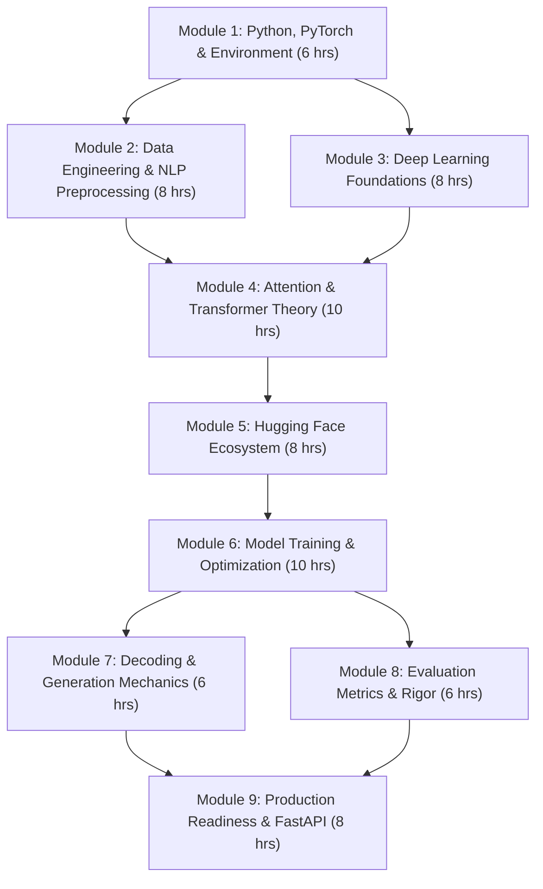

# DESCЯA — Team Learning Roadmap & Deep Learning Syllabus
## A Comprehensive 9-Module Self-Paced Curriculum for Academic NLP Engineering

**Project:** Descra — AI-Powered Product Description Generator  
**Target Audience:** Rudraksh Sachdeva (2481025), Shivansee (2481187), K Jahnvi (2481221), Kriti Abrol (2481214)  
**Objective:** Bridge the gap between foundational Python programming and advanced Deep Learning / Transformer engineering, ensuring all team members can contribute effectively to code, experiments, reports, and oral evaluations.

---

## Curriculum Overview

---

## Module 1: Python Systems, PyTorch Tensors & Hardware Acceleration

- **Estimated Study Time:** 6 hours
- **Prerequisites:** Basic Python syntax (functions, classes, dictionaries, loops).
- **Core Concepts:**
  - Virtual environments (`.venv`), isolation, dependency pinning, and reproducibility.
  - PyTorch `Tensor` data structure, tensor strides, memory layout, and contiguous tensors.
  - Device placement (`cpu` vs `cuda`), CUDA streams, asynchronous memory transfers (`.to(device, non_blocking=True)`).
  - Tensor operations: broadcasting, matrix multiplication (`@` / `torch.matmul`), reshaping (`view`, `reshape`), transposing, slicing.
  - Hardware inspection: VRAM limits, CUDA compute capability, and peak FLOPS.
- **Descra Code Mapping:**
  - `src/descra/utils/hardware.py`: Automated GPU, VRAM, and CUDA compute inspection.
  - `scripts/inspect_hardware.py`: CLI hardware diagnostic utility.
  - `tests/test_hardware.py`: PyTorch GPU GEMM allocation tests.
- **Recommended Reading:**
  - *PyTorch Official Tutorial:* "Deep Learning with PyTorch: A 60 Minute Blitz" (pytorch.org/tutorials).
  - *Documentation:* PyTorch CUDA Semantics (pytorch.org/docs/stable/notes/cuda.html).
- **Self-Check Questions:**
  1. *What is the difference between `tensor.view()` and `tensor.reshape()` in PyTorch?*
     - **Answer:** `view()` requires the underlying tensor to be stored in a contiguous block of memory and creates a new view without copying data. `reshape()` returns a view if memory is contiguous, or copies data to a contiguous buffer if necessary.
  2. *Why should you never call `.numpy()` directly on a CUDA tensor?*
     - **Answer:** NumPy arrays only reside in CPU host RAM. Calling `.numpy()` on a GPU tensor throws a `RuntimeError`. You must first call `.detach().cpu().numpy()`.

---

## Module 2: Data Engineering, NLP Preprocessing & Factual Alignment

- **Estimated Study Time:** 8 hours
- **Prerequisites:** Module 1, familiarity with JSON, Pandas, and string manipulation.
- **Core Concepts:**
  - Schema normalization: converting heterogeneous semi-structured JSON records into strongly typed dataclasses.
  - Data leakage prevention: temporal leakage, train-test contamination, duplicate text hashing.
  - Cleaning pipelines: HTML entity decoding, whitespace normalization, URL/special character stripping.
  - Length gating: avoiding extreme outliers that distort sequence batching.
  - Factual grounding & alignment: computing n-gram overlap between input features and target marketing text to prevent model hallucinations.
  - Deterministic splitting: hash-based ASIN partitioning with exact 80/10/10 stratification.
- **Descra Code Mapping:**
  - `src/descra/data/acquisition.py`: Streaming Parquet ingestion.
  - `src/descra/data/preprocessing.py`: Canonical normalization and deduplication.
  - `src/descra/data/inspection.py`: Statistical schema validation.
  - `src/descra/data/splitting.py`: Deterministic zero-leakage dataset partitioner.
  - `src/descra/data/dataset.py`: PyTorch `Dataset` wrapper and sequence formatter.
- **Recommended Reading:**
  - *Paper:* McAuley et al., "Amazon Product Data" (UCSD Web Mining Lab).
  - *Guide:* "Data Leakage in Machine Learning" by Jason Brownlee.
- **Self-Check Questions:**
  1. *Why did Descra filter out records where target descriptions were identical across distinct ASINs?*
     - **Answer:** Identical boilerplate descriptions (e.g., standard seller shipping policies) appearing across multiple products cause cross-split leakage if one product lands in train and another in test.
  2. *What is the purpose of `needs_review.jsonl`?*
     - **Answer:** It stores raw records that failed length criteria or factual alignment thresholds ($< 0.2$), keeping the training set pristine while preserving discarded data for debugging and error analysis.

---

## Module 3: Deep Learning Foundations (Neurons to Backprop)

- **Estimated Study Time:** 8 hours
- **Prerequisites:** Module 1, multivariable calculus (partial derivatives), linear algebra.
- **Core Concepts:**
  - Affine transformations $\mathbf{W}\mathbf{x} + \mathbf{b}$ and non-linear activations (ReLU, GELU, GEGLU, Softmax).
  - Loss functions: Categorical Cross-Entropy, Negative Log-Likelihood (NLL).
  - The Computational Graph: forward passes, automatic differentiation (`torch.autograd`), backward passes.
  - Optimization algorithms: SGD with momentum, RMSprop, Adam, and AdamW (decoupled weight decay).
  - Regularization: Dropout, Weight Decay ($\ell_2$), Early Stopping, Label Smoothing.
  - Numerical stability: log-sum-exp trick in softmax, gradient underflow/overflow.
- **Descra Code Mapping:**
  - `docs/TRANSFORMER_ARCHITECTURE.md` (Sections 2.1 to 2.4).
  - `tests/test_dataset.py`: PyTorch batch collation and target tensor verification.
- **Recommended Reading:**
  - *Textbook:* Goodfellow, Bengio, Courville, "Deep Learning" (MIT Press), Chapters 6 & 8.
  - *Paper:* Loshchilov & Hutter, "Decoupled Weight Decay Regularization" (ICLR 2019, AdamW).
- **Self-Check Questions:**
  1. *Why does AdamW outperform standard Adam when using $\ell_2$ weight decay?*
     - **Answer:** In standard Adam, weight decay is added to the gradient, distorting the running moving averages of the gradients. AdamW applies weight decay directly to the weights, preserving the scale-invariance of adaptive steps.
  2. *What does setting `ignore_index=-100` do in PyTorch's `nn.CrossEntropyLoss`?*
     - **Answer:** It ignores tokens with target ID `-100` (e.g., padding tokens) so that they contribute $0$ to the loss and gradient computation.

---

## Module 4: Attention Mechanisms & Transformer Theory

- **Estimated Study Time:** 10 hours
- **Prerequisites:** Modules 1, 3.
- **Core Concepts:**
  - The sequence transduction bottleneck in RNNs and LSTMs.
  - Scaled Dot-Product Attention: Query ($\mathbf{Q}$), Key ($\mathbf{K}$), Value ($\mathbf{V}$) matrices.
  - Multi-Head Attention (MHA): representation subspaces and projection matrices.
  - Residual connections and Layer Normalization (Pre-LN vs Post-LN; LayerNorm vs RMSNorm).
  - Positional Encodings: absolute sinusoidal vs relative positional bias (T5 bucketed bias).
  - Encoder-Decoder Cross-Attention mechanics: how the decoder queries encoder representations.
  - Computational complexity of self-attention ($O(N^2 \cdot d)$) vs sequential steps ($O(1)$).
- **Descra Code Mapping:**
  - `docs/TRANSFORMER_ARCHITECTURE.md` (Sections 3 & 4).
  - `notebooks/01_dataset_exploration.ipynb` (Section 4).
- **Recommended Reading:**
  - *Seminal Paper:* Vaswani et al., "Attention Is All You Need" (NeurIPS 2017).
  - *T5 Paper:* Raffel et al., "Exploring the Limits of Transfer Learning with a Unified Text-to-Text Transformer" (JMLR 2020).
  - *Interactive Guide:* Jay Alammar, "The Illustrated Transformer" (jalammar.github.io).
- **Self-Check Questions:**
  1. *Why is the dot product $\mathbf{Q}\mathbf{K}^T$ divided by $\sqrt{d_k}$ in scaled dot-product attention?*
     - **Answer:** For large $d_k$, the dot product grows large in magnitude, driving softmax into regions with near-zero gradients. Scaling by $\sqrt{d_k}$ preserves unit variance ($\text{Var} = 1$).
  2. *How does T5's relative position bias differ from standard sinusoidal positional embeddings?*
     - **Answer:** Instead of adding static vectors to token embeddings, T5 adds a learnable scalar bias directly to each attention logit based on the relative distance $i - j$ between tokens.

---

## Module 5: The Hugging Face Ecosystem & Tokenization

- **Estimated Study Time:** 8 hours
- **Prerequisites:** Modules 2, 4.
- **Core Concepts:**
  - Subword tokenization: Byte-Pair Encoding (BPE), WordPiece, and SentencePiece Unigram.
  - Special tokens: `<pad>`, `</s>`, `<unk>`, and model-specific control tokens.
  - The Hugging Face `transformers` library: `AutoModelForSeq2SeqLM`, `AutoTokenizer`, `AutoConfig`.
  - Tokenizer inputs: `input_ids`, `attention_mask`, `decoder_input_ids`, `labels`.
  - Batch encoding with dynamic padding: `DataCollatorForSeq2Seq`.
  - PyTorch `DataLoader`: batching, shuffling, multi-worker streaming.
- **Descra Code Mapping:**
  - `configs/model.yaml`: Model architecture and tokenizer configurations.
  - `src/descra/data/dataset.py`: `DescraSeq2SeqDataset` and input formatting.
  - `scripts/generate_eda.py`: Subword token length percentile profiling.
- **Recommended Reading:**
  - *Hugging Face Course:* "Chapter 2: Using 🤗 Transformers" & "Chapter 6: Tokenizers" (huggingface.co/learn/nlp-course).
  - *Paper:* Kudo, "Subword Regularization: Improving Neural Network Translation Models with Multiple Subword Candidates" (SentencePiece).
- **Self-Check Questions:**
  1. *What happens if you feed target labels containing padding token ID `0` directly into FLAN-T5 training?*
     - **Answer:** The model will compute cross-entropy loss on padding tokens, teaching it to predict `<pad>` repeatedly rather than actual words. Padding tokens in labels must be masked with `-100`.
  2. *Why does FLAN-T5 use SentencePiece Unigram instead of whitespace splitting?*
     - **Answer:** Whitespace splitting cannot handle out-of-vocabulary words or compound terms. SentencePiece breaks unseen words into common morphemes, keeping vocabulary compact while covering 100% of text.

---

## Module 6: Model Training, Fine-Tuning & GPU Optimization

- **Estimated Study Time:** 10 hours
- **Prerequisites:** Modules 3, 5.
- **Core Concepts:**
  - Transfer learning & instruction fine-tuning: adapting general language priors to domain-specific copy generation.
  - Hyperparameter dynamics: learning rate ($\eta = 5 \times 10^{-4}$), batch size, gradient accumulation.
  - Learning rate scheduling: warmup ratio, linear decay, cosine annealing.
  - Mixed precision training: Automatic Mixed Precision (`torch.cuda.amp.autocast`), FP16 vs BF16, dynamic loss scaling (`GradScaler`).
  - VRAM budgeting: parameter memory, gradient memory, optimizer memory, activation memory.
  - Checkpointing and early stopping: monitoring validation loss to prevent overfitting.
- **Descra Code Mapping:**
  - `configs/training.yaml`: Training hyperparameters, batch sizes, FP16 flags.
  - `reports/hardware/HARDWARE_ASSESSMENT.md`: Detailed RTX 4050 6GB VRAM budget.
- **Recommended Reading:**
  - *Paper:* Chung et al., "Scaling Instruction-Finetuned Language Models" (FLAN-T5, 2022).
  - *NVIDIA Documentation:* "Mixed Precision Training of Deep Neural Networks" (developer.nvidia.com).
- **Self-Check Questions:**
  1. *Why does FP16 mixed precision require a `GradScaler` in PyTorch?*
     - **Answer:** FP16 has a limited exponent range (minimum positive normal $\approx 6 \times 10^{-5}$). Gradients smaller than this underflow to zero. `GradScaler` multiplies loss by a scale factor before backprop to keep gradients in range, then un-scales them before the optimizer step.
  2. *What is Gradient Accumulation and when should it be used?*
     - **Answer:** When GPU VRAM limits physical batch size (e.g., batch size 8), gradient accumulation calculates gradients over multiple mini-batches before calling `optimizer.step()`, simulating an effective batch size of 16 or 32 without extra memory.

---

## Module 7: Autoregressive Text Decoding & Generation

- **Estimated Study Time:** 6 hours
- **Prerequisites:** Modules 4, 5.
- **Core Concepts:**
  - Autoregressive sequence generation: decoding loop and KV caching.
  - Deterministic decoding: Greedy search vs Beam search.
  - Beam search parameters: `num_beams`, `length_penalty`, `early_stopping`.
  - Repetition penalties: `no_repeat_ngram_size`, `repetition_penalty`.
  - Stochastic decoding: Temperature scaling, Top-K filtering, Top-P (Nucleus) sampling.
  - Trade-offs between diversity (creativity) and factual adherence.
- **Descra Code Mapping:**
  - `configs/model.yaml` (`generation` block: `num_beams: 4`, `max_length: 256`, `no_repeat_ngram_size: 3`).
  - `docs/TRANSFORMER_ARCHITECTURE.md` (Section 7).
- **Recommended Reading:**
  - *Hugging Face Blog:* Patrick von Platen, "How to generate text: using different decoding methods for language generation with Transformers".
  - *Paper:* Holtzman et al., "The Curious Case of Neural Text Degeneration" (ICLR 2020, Nucleus Sampling).
- **Self-Check Questions:**
  1. *Why does Greedy Search often produce repetitive, robotic text in language models?*
     - **Answer:** Greedy search makes locally optimal decisions at each token without considering global sequence likelihood, easily trapping the decoder in repetitive loops.
  2. *What does setting `no_repeat_ngram_size=3` enforce during generation?*
     - **Answer:** It dynamically sets the probability of any token that would complete a previously generated 3-gram to zero, preventing repetitive phrases like "great product, great product".

---

## Module 8: Evaluation Metrics & Academic Verification

- **Estimated Study Time:** 6 hours
- **Prerequisites:** Modules 2, 7.
- **Core Concepts:**
  - N-gram precision vs recall: BLEU vs ROUGE.
  - BLEU: modified n-gram precision, brevity penalty (BP).
  - ROUGE suite: ROUGE-1 (unigram recall), ROUGE-2 (bigram recall), ROUGE-L (Longest Common Subsequence).
  - Semantic similarity: BERTScore using contextual DeBERTa/RoBERTa embeddings.
  - Inference profiling: generation latency (ms/token), peak VRAM, throughput (tokens/sec).
  - Human evaluation rubrics: fluency, informativeness, and factual accuracy.
- **Descra Code Mapping:**
  - `configs/evaluation.yaml`: Metric thresholds and benchmark configurations.
  - `reports/eda/eda_summary.json`: Pre-training metric distributions.
- **Recommended Reading:**
  - *Seminal Papers:*
    - Papineni et al., "BLEU: a Method for Automatic Evaluation of Machine Translation" (ACL 2002).
    - Lin, "ROUGE: A Package for Automatic Evaluation of Summaries" (ACL 2004).
    - Zhang et al., "BERTScore: Evaluating Text Generation with BERT" (ICLR 2020).
- **Self-Check Questions:**
  1. *Why is ROUGE preferred over BLEU for summarization and description tasks?*
     - **Answer:** BLEU focuses on precision (how many generated n-grams were in the reference), whereas ROUGE focuses on recall (how much of the key reference information was captured by the model).
  2. *What critical limitation of BLEU/ROUGE does BERTScore address?*
     - **Answer:** BLEU and ROUGE rely on exact surface lexical matches and penalize valid synonyms (e.g., "hydrating" vs "moisturizing"). BERTScore compares dense contextual vector embeddings, recognizing semantic equivalence.

---

## Module 9: Production Readiness, Serving & Phase 2 Architecture

- **Estimated Study Time:** 8 hours
- **Prerequisites:** Modules 1, 5, 6, 7.
- **Core Concepts:**
  - Clean separation of training pipelines and inference engines.
  - RESTful API design with FastAPI and Pydantic schema validation.
  - Model serialization: PyTorch `state_dict`, Hugging Face `save_pretrained()`.
  - Model compression: 8-bit / 4-bit quantization (`bitsandbytes`, AWQ, GPTQ).
  - Inference acceleration: ONNX Runtime, TensorRT-LLM, TorchScript.
  - Containerization: Dockerfiles, health-check endpoints, and stateless serving.
- **Descra Code Mapping:**
  - `configs/model.yaml`: Model checkpointing paths.
  - `docs/ROADMAP_PHASE1.md`: Phase 2 integration milestones.
- **Recommended Reading:**
  - *FastAPI Documentation:* "FastAPI Tutorial — User Guide" (fastapi.tiangolo.com).
  - *Guide:* Hugging Face "Export to ONNX" (huggingface.co/docs/transformers/serialization).
- **Self-Check Questions:**
  1. *Why should the model weights be loaded during FastAPI application startup (lifespan event) rather than inside the request endpoint function?*
     - **Answer:** Loading model weights takes several seconds and allocates GPU memory. Doing this per-request would cause massive latency spikes and out-of-memory crashes. Loading once at startup allows instant parallel inference.
  2. *What is model quantization and what trade-off does it introduce?*
     - **Answer:** Quantization converts 32-bit or 16-bit floating-point weights into 8-bit or 4-bit integers. It drastically cuts VRAM usage and speeds up memory-bandwidth-bound inference, with only minor degradations in perplexity.

