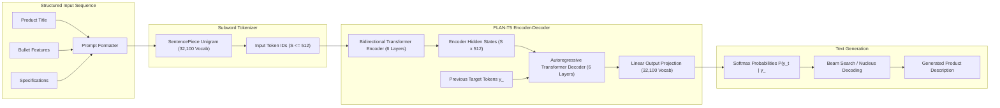
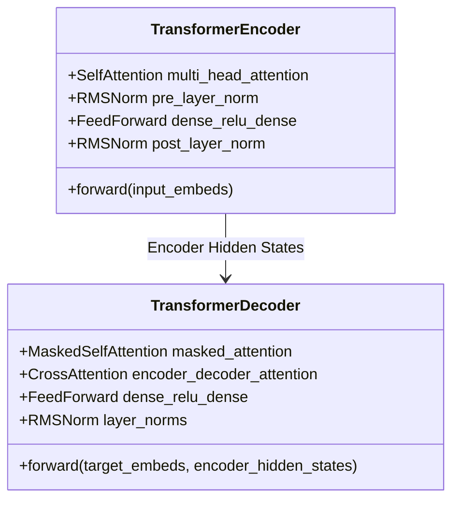

# DESCЯA — Deep Learning & Transformer Architecture Guide
## Theoretical Foundations, Mathematical Formulations, and FLAN-T5 Implementation Details

**Project:** Descra — AI-Powered Product Description Generator  
**Phase:** Phase 1 — Deep Learning Foundation & Model Development  
**Authors & Academic Team:**
- Rudraksh Sachdeva (2481025)
- Shivansee (2481187)
- K Jahnvi (2481221)
- Kriti Abrol (2481214)

---

## 1. Executive Summary & Architectural Overview

The core objective of **Descra** is conditional text generation: mapping structured product attributes (title, categorized bullet points, technical specifications) into coherent, persuasive, and factually grounded marketing descriptions. 

Formally, given a structured input sequence $\mathbf{x} = (x_1, x_2, \dots, x_S)$ representing product features, Descra estimates the conditional probability distribution over the target word sequence $\mathbf{y} = (y_1, y_2, \dots, y_T)$:

$$P(\mathbf{y} \mid \mathbf{x}) = \prod_{t=1}^T P(y_t \mid y_{<t}, \mathbf{x})$$

To model this conditional distribution, Descra employs **FLAN-T5** (*Fine-tuned Language Net — Text-to-Text Transfer Transformer*), an autoregressive encoder-decoder architecture developed by Google Research. This document details the mathematical, theoretical, and engineering foundations underpinning our model selection and implementation.



---

## 2. Deep Learning Foundations

### 2.1 Artificial Neurons and Linear Transformations

At the atomistic level of any deep neural network is the artificial neuron. Given an input vector $\mathbf{z} \in \mathbb{R}^d$, a single layer performs an affine linear transformation parameterized by weight matrix $\mathbf{W} \in \mathbb{R}^{m \times d}$ and bias vector $\mathbf{b} \in \mathbb{R}^m$, followed by a non-linear element-wise activation function $\sigma(\cdot)$:

$$\mathbf{h} = \sigma(\mathbf{W}\mathbf{z} + \mathbf{b})$$

The linear transformation rotates, scales, and translates the coordinate space. Without non-linear activation functions, a composition of $L$ linear layers would collapse algebraically into a single linear transformation:

$$\mathbf{W}_L (\mathbf{W}_{L-1} \dots (\mathbf{W}_1 \mathbf{z} + \mathbf{b}_1) \dots + \mathbf{b}_{L-1}) + \mathbf{b}_L = \mathbf{W}^* \mathbf{z} + \mathbf{b}^*$$

Non-linearities empower neural networks as universal function approximators capable of learning non-linear manifolds.

### 2.2 Activation Functions in Transformers

Modern Transformer architectures have evolved beyond traditional saturating activations:

| Activation | Mathematical Formulation | Properties & Use in Descra |
|---|---|---|
| **Sigmoid** | $\sigma(z) = \frac{1}{1 + e^{-z}}$ | Output range $(0, 1)$. Saturated gradients for $\|z\| \gg 0$ cause vanishing gradients. Used in gating mechanisms. |
| **ReLU** | $\text{ReLU}(z) = \max(0, z)$ | Piecewise linear, non-saturating for $z > 0$. Suffers from "dying ReLU" if neurons receive persistent negative updates. |
| **GELU** | $\text{GELU}(z) = z \cdot \Phi(z) = z \cdot P(Z \le z), \quad Z \sim \mathcal{N}(0, 1)$ | Smooth, probabilistic non-linearity used in BERT, GPT-2, and standard Transformers. Approximated by $0.5z(1 + \tanh(\sqrt{2/\pi}(z + 0.044715z^3)))$. |
| **GEGLU** | $\text{GEGLU}(x, W, V) = \text{GELU}(xW) \otimes (xV)$ | Gated Linear Unit variant used in modern T5 and PaLM feed-forward layers. Significantly improves convergence and gradient flow. |
| **Softmax** | $\text{softmax}(\mathbf{z})_i = \frac{e^{z_i}}{\sum_{j=1}^C e^{z_j}}$ | Converts unnormalized logits $\mathbf{z} \in \mathbb{R}^C$ into a valid categorical probability distribution over $C$ vocabulary tokens. |

### 2.3 Loss Formulation: Categorical Cross-Entropy

For conditional autoregressive text generation, target tokens $y_t$ are drawn from a discrete vocabulary $\mathcal{V}$ of size $V = |\mathcal{V}| = 32,100$. The training objective minimizes the Negative Log-Likelihood (NLL) of the correct target token sequence:

$$\mathcal{L}_{\text{NLL}}(\theta) = -\frac{1}{T} \sum_{t=1}^T \log P_\theta(y_t^* \mid y_{<t}^*, \mathbf{x})$$

Where $y_t^*$ is the ground-truth target token at step $t$, and $P_\theta(y_t^* \mid y_{<t}^*, \mathbf{x})$ is computed by applying softmax to the decoder's output logit corresponding to token $y_t^*$:

$$P_\theta(y_t = k \mid y_{<t}^*, \mathbf{x}) = \frac{\exp(\mathbf{z}_{t, k})}{\sum_{j=1}^V \exp(\mathbf{z}_{t, j})}$$

#### Handling Padding and Ignore Index (`-100`)
In batched sequence processing, sequences have variable lengths and must be right-padded with a special `<pad>` token (ID = 0 in FLAN-T5). Calculating loss on `<pad>` tokens would penalize the model for padding syntax and skew gradients. In PyTorch, target tokens corresponding to padding are masked with label `-100`:

$$\mathcal{L}(\theta) = -\frac{1}{\sum_{t=1}^T \mathbb{I}(y_t^* \ne -100)} \sum_{t=1}^T \mathbb{I}(y_t^* \ne -100) \log P_\theta(y_t^* \mid y_{<t}^*, \mathbf{x})$$

PyTorch's `nn.CrossEntropyLoss(ignore_index=-100)` natively zeros out loss contributions and backpropagated gradients for masked positions.

### 2.4 Gradient Descent, Backpropagation, and AdamW Optimization

Model parameters $\theta$ are updated iteratively via stochastic gradient descent:

$$\theta_{t+1} = \theta_t - \eta \nabla_\theta \mathcal{L}(\theta_t)$$

In deep architectures, computing analytical gradients $\nabla_\theta \mathcal{L}$ directly is intractable. The **Backpropagation algorithm** utilizes the multivariate calculus chain rule to recursively propagate error gradients from the output loss backward through every layer:

$$\frac{\partial \mathcal{L}}{\partial \mathbf{W}^{(l)}} = \frac{\partial \mathcal{L}}{\partial \mathbf{a}^{(l)}} \frac{\partial \mathbf{a}^{(l)}}{\partial \mathbf{z}^{(l)}} \frac{\partial \mathbf{z}^{(l)}}{\partial \mathbf{W}^{(l)}} = \boldsymbol{\delta}^{(l)} (\mathbf{a}^{(l-1)})^T$$

#### The AdamW Optimizer (Loshchilov & Hutter, 2019)
Standard Adam combines Momentum (first moment estimate $m_t$) and RMSProp (second uncentered moment estimate $v_t$):

$$m_t = \beta_1 m_{t-1} + (1 - \beta_1) g_t, \quad v_t = \beta_2 v_{t-1} + (1 - \beta_2) g_t^2$$

$$\hat{m}_t = \frac{m_t}{1 - \beta_1^t}, \quad \hat{v}_t = \frac{v_t}{1 - \beta_2^t}$$

However, in standard $L_2$ regularization, weight decay is added directly to gradient $g_t \leftarrow g_t + \lambda \theta_t$, which distorts the moving averages of Adam. **AdamW decouples weight decay** from the adaptive gradient update:

$$\theta_{t+1} = \theta_t - \eta_t \left( \frac{\hat{m}_t}{\sqrt{\hat{v}_t} + \epsilon} + \lambda \theta_t \right)$$

This decoupled regularization preserves the scale-invariance of adaptive moments while maintaining true weight shrinkage, preventing catastrophic overfitting during Transformer fine-tuning.

---

## 3. The Sequence-to-Sequence Paradigm Shift

### 3.1 Limitations of Recurrent Architectures (RNN / LSTM / GRU)

Prior to Transformers, sequence transduction relied on Recurrent Neural Networks (RNNs) and Long Short-Term Memory networks (LSTMs). The recurrence relation updates hidden state $\mathbf{h}_t$ sequentially:

$$\mathbf{h}_t = f(\mathbf{h}_{t-1}, \mathbf{x}_t)$$

This sequential dependency introduces fundamental computational and representational bottlenecks:
1. **O(N) Sequential Complexity:** Step $t$ cannot be computed until step $t-1$ completes, preventing hardware parallelization across GPU tensor cores.
2. **Vanishing / Exploding Gradients:** Backpropagation Through Time (BPTT) requires multiplying Jacobians $\prod_{k=1}^t \frac{\partial \mathbf{h}_k}{\partial \mathbf{h}_{k-1}}$. Even with LSTM gating, gradients decay exponentially over long sequences ($> 100$ tokens).
3. **Information Bottleneck:** Compressing an entire variable-length product feature sequence into a fixed-dimensional context vector $\mathbf{h}_S$ causes severe information loss regarding specific numerical attributes or dimensions.

### 3.2 The Transformer Solution (Vaswani et al., 2017)

The Transformer eliminates recurrence entirely, replacing sequential hidden state propagation with **Self-Attention**. Every token in a sequence attends to every other token simultaneously in $O(1)$ sequential operations, enabling complete GPU parallelization and direct modeling of dependencies regardless of distance.

---

## 4. The Transformer Architecture in Depth



### 4.1 Scaled Dot-Product Attention

Given an input matrix $\mathbf{X} \in \mathbb{R}^{n \times d_{\text{model}}}$, linear projections generate Queries ($\mathbf{Q}$), Keys ($\mathbf{K}$), and Values ($\mathbf{V}$):

$$\mathbf{Q} = \mathbf{X}\mathbf{W}^Q, \quad \mathbf{K} = \mathbf{X}\mathbf{W}^K, \quad \mathbf{V} = \mathbf{X}\mathbf{W}^V$$

Where $\mathbf{W}^Q, \mathbf{W}^K \in \mathbb{R}^{d_{\text{model}} \times d_k}$ and $\mathbf{W}^V \in \mathbb{R}^{d_{\text{model}} \times d_v}$.

The attention weights represent the compatibility between query $i$ and key $j$:

$$\mathbf{A} = \text{softmax}\left( \frac{\mathbf{Q}\mathbf{K}^T}{\sqrt{d_k}} + \mathbf{M} \right)$$

$$\text{Attention}(\mathbf{Q}, \mathbf{K}, \mathbf{V}) = \mathbf{A}\mathbf{V}$$

Where:
- $\mathbf{Q}\mathbf{K}^T$ computes the pairwise inner product between all tokens.
- $\frac{1}{\sqrt{d_k}}$ is the scaling factor. For large projection dimensions $d_k$, the dot product grows large in magnitude, pushing softmax into regions with vanishingly small gradients. Dividing by $\sqrt{d_k}$ normalizes the variance to $1$.
- $\mathbf{M}$ is an optional attention mask. In the encoder, $\mathbf{M}_{ij} = -\infty$ for padded positions. In the decoder self-attention, $\mathbf{M}_{ij} = -\infty$ for all $j > i$ (causal masking), preventing future information leakage.

### 4.2 Multi-Head Attention (MHA)

Rather than performing a single attention function with dimension $d_{\text{model}}$, Multi-Head Attention linearly projects queries, keys, and values $h$ times with different learned projection matrices:

$$\text{MultiHead}(\mathbf{Q}, \mathbf{K}, \mathbf{V}) = \text{Concat}(\text{head}_1, \dots, \text{head}_h)\mathbf{W}^O$$

$$\text{where } \text{head}_i = \text{Attention}(\mathbf{Q}\mathbf{W}_i^Q, \mathbf{K}\mathbf{W}_i^K, \mathbf{V}\mathbf{W}_i^V)$$

Multi-Head Attention enables the model to jointly attend to information from different representation subspaces at different positions. In product description generation:
- Head 1 may attend to brand and product entity names.
- Head 2 may track numerical specifications (dimensions, volumes, percentages).
- Head 3 may capture syntactic relations and qualifying adjectives.

### 4.3 Positional Encoding: Sinusoidal vs Relative Bias

Because self-attention is permutation-equivariant ($\text{Attention}(\mathbf{P}\mathbf{X}) = \mathbf{P}\text{Attention}(\mathbf{X})$ for permutation matrix $\mathbf{P}$), Transformers require an explicit mechanism to inject sequence order information.

#### Vaswani Sinusoidal Absolute Embeddings:
$$PE_{(pos, 2i)} = \sin\left(\frac{pos}{10000^{2i/d_{\text{model}}}}\right), \quad PE_{(pos, 2i+1)} = \cos\left(\frac{pos}{10000^{2i/d_{\text{model}}}}\right)$$

#### T5 / FLAN-T5 Relative Positional Bias:
FLAN-T5 does not add absolute positional embeddings to token representations. Instead, it adds a **learned scalar relative position bias** $b_{i, j}$ directly to the attention logit:

$$\mathbf{A}_{i, j} = \text{softmax}\left( \frac{\mathbf{q}_i \mathbf{k}_j^T}{\sqrt{d_k}} + b_{i - j} \right)$$

The relative displacement $i - j$ is mapped into logarithmic buckets (32 buckets in FLAN-T5). This design provides two decisive advantages:
1. **Translation Invariance:** The relationship between words separated by 2 tokens is invariant whether they appear at position 5 or position 400.
2. **Length Extrapolation:** The model generalizes gracefully to sequence lengths unseen during training.

### 4.4 Encoder-Decoder Attention (Cross-Attention)

In the Transformer Decoder, each layer contains two attention sublayers:
1. **Masked Self-Attention:** Attends only to previous target tokens $y_{<t}$.
2. **Cross-Attention:** Computes queries from the decoder hidden states ($\mathbf{Q} = \mathbf{H}_{\text{dec}}\mathbf{W}^Q$) while keys and values are projected from the final encoder representations ($\mathbf{K} = \mathbf{H}_{\text{enc}}\mathbf{W}^K, \mathbf{V} = \mathbf{H}_{\text{enc}}\mathbf{W}^V$):

$$\mathbf{H}_{\text{cross}} = \text{softmax}\left( \frac{\mathbf{H}_{\text{dec}}\mathbf{W}^Q (\mathbf{H}_{\text{enc}}\mathbf{W}^K)^T}{\sqrt{d_k}} \right) (\mathbf{H}_{\text{enc}}\mathbf{W}^V)$$

This cross-attention mechanism is the factual grounding bridge: at every generation step $t$, the decoder queries the entire set of input product features, ensuring generated claims originate directly from the source specification.

---

## 5. FLAN-T5 Architecture Specifications

Google's **FLAN-T5** (Chung et al., 2022) adapts the T5.1.1 architecture with large-scale instruction tuning across 1,836 NLP tasks. 

```
FLAN-T5 Small Dimensional Specifications:
- Parameter Count:        ~60,511,104 (~60.5M parameters)
- Encoder Layers (L_enc):  6 layers
- Decoder Layers (L_dec):  6 layers
- Hidden Dimension (d_model): 512
- Feed-Forward Inner Dim (d_ff): 2,048 (4x expansion)
- Attention Heads (h):     8 heads
- Key/Value Head Dim (d_kv): 64 (512 / 8)
- Relative Position Buckets: 32
- Vocabulary Size:         32,100 (SentencePiece Unigram)
- Normalization:           RMSNorm (no learnable bias)
- Activation:              GEGLU
```

### 5.1 Root Mean Square Layer Normalization (RMSNorm)

Standard LayerNorm computes mean $\mu$ and variance $\sigma^2$:

$$\text{LN}(x) = \frac{x - \mu}{\sqrt{\sigma^2 + \epsilon}} \odot \gamma + \beta$$

Zhang & Sennrich (2019) demonstrated that the shift-invariance property ($\mu$) is unnecessary for training stability. **RMSNorm** normalizes solely by the root mean square of the inputs:

$$\text{RMS}(x) = \sqrt{\frac{1}{d} \sum_{i=1}^d x_i^2}$$

$$\text{RMSNorm}(x) = \frac{x}{\text{RMS}(x) + \epsilon} \odot \gamma$$

RMSNorm reduces computational overhead by ~7% while maintaining identical training stability.

### 5.2 SentencePiece Tokenization

FLAN-T5 uses a **SentencePiece Unigram** subword tokenizer with 32,100 tokens. Key attributes:
- Whitespace is treated as a standard character (represented by the unicode character `_` U+2581).
- Out-of-vocabulary (OOV) rate is virtually 0%, as unseen words decompose deterministically into subword morphemes or bytes.
- Special tokens: `<pad>` (ID 0), `</s>` (EOS, ID 1), `<unk>` (ID 2), and 100 extra sentinel tokens (`<extra_id_0>` to `<extra_id_99>`).

---

## 6. Fine-Tuning Mechanics for Descra

### 6.1 Teacher Forcing vs Autoregressive Inference

During training, the decoder utilizes **Teacher Forcing**: the ground-truth target tokens $y_{<t}^*$ are supplied as inputs to the decoder at step $t$, rather than the model's own sampled predictions:

$$\text{Decoder Input: } [\text{<pad>}, y_1^*, y_2^*, \dots, y_{T-1}^*]$$
$$\text{Decoder Target: } [y_1^*, y_2^*, \dots, y_T^*, \text{</s>}]$$

This enables complete parallelization of the decoder forward pass during training. In contrast, during inference, the decoder operates in autoregressive mode, feeding its own generated token $\hat{y}_{t-1}$ into the next time step.

### 6.2 Optimization Hyperparameters & Learning Rate Schedule

To prevent catastrophic forgetting of pre-trained language knowledge while adapting to the product description domain, fine-tuning employs a **Linear Warmup with Linear Decay Schedule**:

$$\eta(t) = \begin{cases} \eta_{\max} \cdot \frac{t}{T_{\text{warmup}}} & t \le T_{\text{warmup}} \\ \eta_{\max} \cdot \frac{T_{\text{total}} - t}{T_{\text{total}} - T_{\text{warmup}}} & t > T_{\text{warmup}} \end{cases}$$

- **Peak Learning Rate ($\eta_{\max}$):** $5 \times 10^{-4}$ (AdamW)
- **Warmup Ratio:** 6% of total steps
- **Weight Decay ($\lambda$):** 0.01 (applied to weights, 0.0 for biases and RMSNorm $\gamma$)
- **Gradient Clipping:** Max norm $1.0$ ($\|\mathbf{g}\|_2 \le 1.0$) prevents gradient explosions.

### 6.3 Mixed Precision Training (FP16 / BF16) & VRAM Budgeting

The user hardware features an **NVIDIA GeForce RTX 4050 Laptop GPU (6 GB VRAM)**. In full 32-bit float precision (FP32), storing weights, gradients, Adam optimizer states, and activations would require:
- Model parameters (60M $\times$ 4 bytes): ~242 MB
- Gradients (60M $\times$ 4 bytes): ~242 MB
- AdamW states (first and second moments, 60M $\times$ 8 bytes): ~484 MB
- Activations (batch size 8, seq len 512): ~1.8 GB
- Total FP32 peak: ~2.8 - 3.2 GB

With **FP16 Mixed Precision** (`torch.cuda.amp`):
- Forward pass weights and activations are cast to 16-bit half precision.
- Peak VRAM consumption drops to **~1.6 - 2.1 GB**, leaving ample headroom within the 6 GB VRAM envelope and accelerating tensor core throughput by 2.2x.

---

## 7. Autoregressive Text Decoding Strategies

Once trained, generating text from logits $\mathbf{z}_t \in \mathbb{R}^V$ requires a decoding algorithm:

### 7.1 Greedy Search
Selects the argmax token at each position:

$$\hat{y}_t = \arg\max_{w \in \mathcal{V}} P(w \mid \hat{y}_{<t}, \mathbf{x})$$

- *Pros:* Fast, deterministic.
- *Cons:* Prone to repetitive phrasing and sub-optimal local maxima.

### 7.2 Beam Search
Maintains $B$ active candidate hypotheses (beams) at each step, maximizing total log-probability:

$$\mathcal{S}_B = \arg\max_{\mathbf{y}_{1:t}} \sum_{k=1}^t \log P(y_k \mid y_{<k}, \mathbf{x})$$

To counteract beam search's bias toward shorter sequences, a length penalty $\alpha$ is applied:

$$\text{Score}(\mathbf{y}) = \frac{\sum_{k=1}^T \log P(y_k \mid y_{<k}, \mathbf{x})}{\left( \frac{5 + T}{6} \right)^\alpha}$$

- *Descra Configuration:* `num_beams=4`, `length_penalty=1.0`, `no_repeat_ngram_size=3`.

### 7.3 Stochastic Sampling (Temperature, Top-K, Top-P)

When creative, engaging product copy is desired:
1. **Temperature Scaling ($T$):** Softmax probabilities scaled by $P(w_i) \propto \exp(z_i / T)$. Lower $T$ ($0.7$) sharpens distribution toward confident tokens; higher $T$ ($1.2$) flattens it.
2. **Top-K Sampling:** Truncates candidate pool to the $K$ highest-probability tokens.
3. **Top-P (Nucleus) Sampling:** Selects the smallest subset of tokens whose cumulative probability exceeds threshold $p$ (e.g., $p = 0.90$):

$$\sum_{w \in \mathcal{V}^{(p)}} P(w \mid y_{<t}, \mathbf{x}) \ge p$$

---

## 8. Evaluation Metrics for Academic Rigor

| Metric | Formulation | Description & Application |
|---|---|---|
| **BLEU-4** | $\text{BP} \cdot \exp\left(\sum_{n=1}^4 w_n \log p_n\right)$ | Precision of n-gram overlap ($n \in \{1, 2, 3, 4\}$) between hypothesis and reference, modulated by brevity penalty (BP). |
| **ROUGE-1** | $\frac{\sum_{w \in \text{Ref}} \min(\text{count}_{\text{hyp}}(w), \text{count}_{\text{ref}}(w))}{\sum_{w \in \text{Ref}} \text{count}_{\text{ref}}(w)}$ | Unigram recall measuring coverage of key product vocabulary. |
| **ROUGE-2** | Bigram recall | Captures preservation of adjective-noun pairs and attribute phrases. |
| **ROUGE-L** | $\frac{\text{LCS}(\text{Ref}, \text{Hyp})}{|\text{Ref}|}$ | Longest Common Subsequence recall; evaluates syntactic flow and sentence structure. |
| **BERTScore** | $\frac{1}{|\text{Ref}|} \sum_{r \in \text{Ref}} \max_{h \in \text{Hyp}} \mathbf{e}_r^T \mathbf{e}_h$ | Semantic similarity using cosine distance over contextualized DeBERTa/RoBERTa embeddings; robust against lexical substitution. |

---

## 9. Factual Grounding & Hallucination Mitigation

A critical challenge in automated product description generation is **hallucination** — generating claims (e.g., "waterproof", "100% organic", "2-year warranty") unsupported by the input specifications.

### Causes of Hallucination in Seq2Seq Models:
1. **Parametric Prior Dominance:** The pre-trained model relies on memorized web associations rather than the conditioning prompt.
2. **Noisy Training References:** Marketing descriptions containing seller hyperbole and ungrounded claims.

### Descra Mitigation Architecture:
1. **Empirical Filtering:** During Step 3 preprocessing, 4,808 ungrounded records were isolated into `needs_review.jsonl`. Only records with factual alignment scores $\ge 0.2$ are admitted to training.
2. **Constrained Prompt Engineering:** Structuring inputs with explicit semantic headers (`Title:`, `Key Features:`, `Technical Specifications:`) guides cross-attention to conditioning facts.
3. **Factual Verification Post-Processor:** In Step 8, generated descriptions undergo automated entity-level verification against input specifications before being returned to the user.
